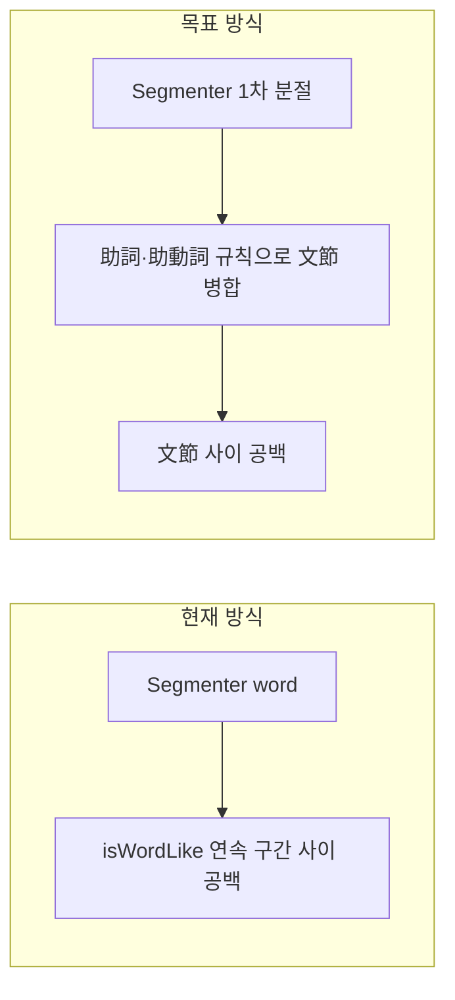
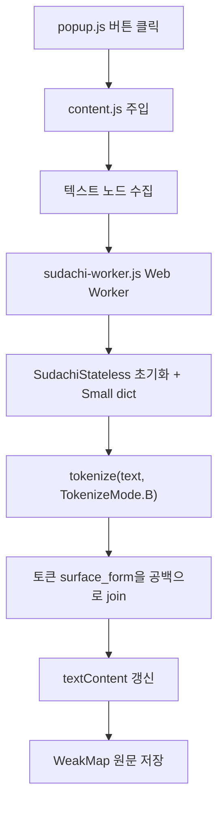
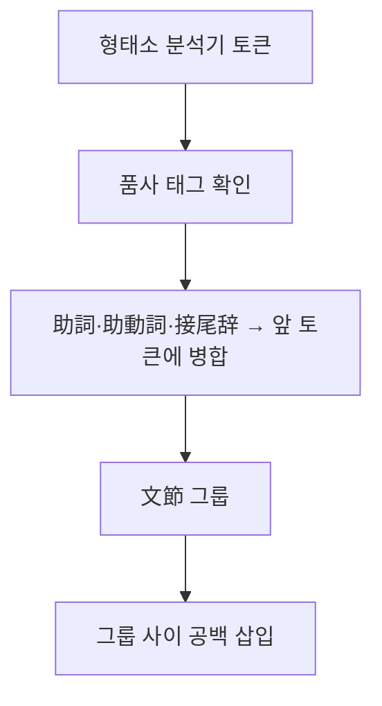

# 한국어식 띄어쓰기(文節) 분석 및 개선 계획

## 0. 배포 전제 (로컬 전용)

- **Chrome Web Store에 올리지 않음** — `chrome://extensions` → 개발자 모드 → 「압축해제된 확장 프로그램을 로드합니다」로만 사용
- Store ZIP 용량 제한·심사·원격 업데이트 고려 **불필요**
- Sudachi **Core dict(~207MB)** 도 로컬 sideload에서는 **기술적으로 가능** (용량·초기 로드만 trade-off)
- **1차 구현은 Small dict 유지** — 로드 속도·디스크 부담이 적음. 품질 부족 시 Core로 교체 가능 (로컬 전용이라 Store 제약 없음)

---

## 1. 한국어 vs 일본어 vs 현재 구현

### 한국어 띄어쓰기가 주는 ‘읽기 리듬’
- 공백은 **의미 단위(어절)** 사이에 들어갑니다.
- 조사는 앞말에 붙고, 다음 어절과는 공백으로 구분합니다.
- 예: `오늘은` + `좋은` + `날씨` + `입니다` → `오늘은 좋은 날씨입니다`

### 일본어 원문
- 기본적으로 공백이 없고, **文節(문节)** 단위로 끊어 읽는 것이 자연스럽습니다.
- 예: `今日は良い天気です` → 읽기 단위는 `今日は / 良い / 天気 / です`

### 현재 확장 ([content.js](c:\portfolio-chrome\일본어 띄어쓰기 플러그인\content.js))

```39:55:c:\portfolio-chrome\일본어 띄어쓰기 플러그인\content.js
  function addWordSpaces(text) {
    // ...
    for (const { segment, isWordLike } of segmenter.segment(text)) {
      if (result && isWordLike && previousWordLike) {
        result += ' ';
      }
      result += segment;
      previousWordLike = isWordLike;
    }
    return result;
  }
```

- **연속 `isWordLike` 세그먼트 사이**에만 공백을 넣습니다.
- 이는 ICU/V8의 **사전적 word break**에 가깝고, 한국어 **어절(文節) 호흡**과는 다릅니다.



---

## 2. 왜 지금 결과가 ‘한국어처럼’ 느껴지지 않는가

| 현상 | 원인 | 한국어식 기대와의 차이 |
|------|------|------------------------|
| `今日は` vs `今日 / は` | Segmenter가 조사를 분리할 수 있음 | 한국어 `오늘은`처럼 **조사는 앞 어절에 붙어야** 함 |
| `良い天気` 한 덩어리 | 복합명사·수식+명사를 하나의 word로 인식 | `좋은 / 날씨`처럼 **수식어+명사를 나누고 싶을 수 있음** |
| `行きました` 분리 방식 | 활용어 endings가 word 경계와 불일치 | `갔습니다`처럼 **용언+어미 한 어절**로 보고 싶음 |
| 공백 밀도 불균일 | word break 품질·페이지마다 다름 | 한국어는 어절마다 **일정한 리듬** |
| 고유명사·カタカナ | 긴 덩어리 유지 | 한 덩어리로 남아 **호흡이 길어짐** |

**핵심 차이**: 한국어 어절 ≈ 일본어 **文節**(내용어 + 붙는 助詞·助動詞), 그러나 현재 코드는 **Segmenter word**를 그대로 공백 처리합니다.

---

## 3. 목표 출력 (文節 / 어절 대응)

| 원문 | 목표 (文節) | 한국어 대응 감각 |
|------|-------------|------------------|
| `今日は良い天気です` | `今日は 良い 天気 です` | `오늘은 / 좋은 / 날씨 / 입니다` |
| `私は学校に行きました` | `私は 学校に 行き ました` | `나는 / 학교에 / 갔습니다` |
| `本を読んでいます` | `本を 読んで います` | `책을 / 읽고 있습니다` |
| `東京タワーに行きたい` | `東京タワーに 行き たい` | (고유명사+조사) / (동사+보조) |

원칙:
1. **文節 내부**에는 공백 없음 (`学校に`, `行きました`)
2. **文節 사이**에만 공백 (`私は` + `学校に`)
3. 조사·접속·보조 활용은 **앞 文節에 흡수** (한국어 조사 붙임과 동일)

---

## 4. 채택 경로: Sudachi WASM Mode B (경로 C)

**사용자 선택**: **Sudachi WASM + TokenizeMode B** 채택. Mode B는 文節(한국어 어절) 호흡에 가장 가깝습니다.



### 4-1. 사용 라이브러리

| 항목 | 선택 |
|------|------|
| WASM 래퍼 | [sudachi-wasm333](https://github.com/Benjas333/sudachi-wasm333) |
| 사전 | **SudachiDict Small** (UniDic 기반) |
| 분절 모드 | **TokenizeMode.B** (Medium — 文節에 근접) |
| 실행 위치 | **Web Worker** (UI 블로킹 방지) |

### 4-2. 띄어쓰기 변환

```javascript
const tokens = JSON.parse(sudachi.tokenize_stringified(text, TokenizeMode.B));
return tokens.map(t => t.surface).join(' ');
```

### 4-3. 파일 구조 (신규)

```
lib/sudachi/           # WASM + Small dict (vendored)
sudachi-worker.js      # Worker: 초기화·tokenize
content.js             # Worker 호출, DOM 적용·복원
manifest.json          # web_accessible_resources
popup.html/js          # 「사전 로드 중…」 UI
```

### 4-4. Trade-off (로컬 sideload 기준)

| 항목 | Small dict (1차) | Core dict (로컬 업그레이드 옵션) |
|------|------------------|----------------------------------|
| 확장 용량 | 수 MB~수십 MB | **~200MB+** (Store 제한 없음 → sideload OK) |
| 첫 적용 | Worker + dict 1~3초 | 로드 수백 ms~수초 (환경·디스크에 따름) |
| 어휘 커버 | UniDic Small | 신조어·固有名詞 등 **더 넓음** |
| upstream 주의 | sudachi-wasm333 vendoring 전 실측 | 동일 |
| 라이선스 | Apache-2.0 — README attribution | 동일 |

---

## 5. 한계 (README에 반드시 명시)

| 케이스 | 예시 | 한계 |
|--------|------|------|
| Small dict | 신조어·固有名詞 | Core/Full 대비 커버리지 낮음 |
| Mode B | `良い天気` | B는 `良い / 天気` (수식 분리 — 목표에 부합) |
| 혼합 텍스트 | URL·코드 혼입 | 일본어 구간만 선택 처리 |
| 초기 로드 | 첫 클릭 | dict 로드 지연 |

---

## 6. 변경 파일

| 파일 | 변경 |
|------|------|
| [content.js](c:\portfolio-chrome\일본어 띄어쓰기 플러그인\content.js) | Worker 연동, Sudachi spacing, 저장·복원 유지 |
| **sudachi-worker.js** (신규) | Sudachi 초기화, Mode B tokenize |
| **lib/sudachi/** (신규) | WASM + dict vendored |
| [manifest.json](c:\portfolio-chrome\일본어 띄어쓰기 플러그인\manifest.json) | `web_accessible_resources` |
| [popup.html/js](c:\portfolio-chrome\일본어 띄어쓰기 플러그인\popup.js) | 로딩·오류 UI |
| [README.md](c:\portfolio-chrome\일본어 띄어쓰기 플러그인\README.md) | Sudachi·Mode B·용량·라이선스 |
| Memory Bank | systemPatterns, techContext, activeContext |

---

## 7. 테스트 시나리오 (수동)

기본 문장:
- `今日は良い天気です` → `今日は 良い 天気 です`
- `私は学校に行きました` → `私は 学校に 行き ました`
- `本を読んでいます` → `本を 読んで います`

회귀:
- 적용 2회 → 공백 중복 없음
- 복원 → 원문 일치
- `input`, `textarea`, `code`, `pre`, `contenteditable` 미변경

엣지:
- `2024年10月1日` (숫자+漢字)
- `Pythonを勉強しています` (混在)
- `「こんにちは」と言った` (引用符)

---

## 8. 구현 우선순위 (경로 C)

1. **Phase 1**: sudachi-wasm333 + Small dict vendoring, Worker 초기화 확인
2. **Phase 2**: content.js 연동 — 텍스트 노드 batch tokenize → 공백 삽입
3. **Phase 3**: popup 로딩 UI, README·라이선스, Memory Bank 갱신
4. **Phase 4 (선택)**: Mode B/C 토글, 혼합 텍스트 fallback, IndexedDB dict 캐시

---

## 9. 전문 오픈소스 형태소 분석기 옵션 (2026 기준)

한국어 어절에 가까운 **文節 띄어쓰기**를 만들 때, 브라우저·Chrome 확장에서 쓸 수 있는 대표 OSS는 아래와 같습니다.

### 9-1. 비교표

| 분석기 | 언어/형태 | 브라우저 | 사전 크기(대략) | 라이선스 | 文節에 가까운 출력 |
|--------|-----------|----------|-----------------|----------|-------------------|
| **MeCab** | C++ → WASM | 가능 ([mecab-wasm](https://github.com/itayperl/mecab-wasm), [mecab-web-worker](https://github.com/leyhline/mecab-web-worker)) | IPADic ~30MB, UniDic 더 큼 | MeCab: GPL/LGPL/BSD, 사전별 상이 | 형태소 단위 → POS로 文節 병합 필요 |
| **Kuromoji.js** | Pure JS | **가장 검증됨** ([takuyaa/kuromoji.js](https://github.com/takuyaa/kuromoji.js)) | dict `*.dat` ~16MB | Apache-2.0 | 토큰+품사 → 助詞/助動詞 병합 규칙 필요 |
| **Sudachi** | Rust → WASM | [sudachi-wasm333](https://github.com/Benjas333/sudachi-wasm333) | Small 내장 / Core **~207MB** | Apache-2.0 | **Mode B/C**가 文節에 가장 근접 |
| **Lindera** | Rust → WASM | [lindera-wasm-web-ipadic](https://www.npmjs.com/package/lindera-wasm-web-ipadic) | **~13MB** 내장 | MIT | 형태소 단위 → POS 병합 필요 |
| **Kagome** | Go → WASM | 가능 | ~15MB | MIT | MeCab 계열, 초기 로드 느림 |
| **Intl.Segmenter** | 브라우저 내장 | 즉시 | 0 | — | word break 수준, 文節 품질 낮음 |

### 9-2. Sudachi TokenizeMode (文節 목표에 특히 중요)

Sudachi는 분절 **세 가지 모드**를 제공합니다.

| 모드 | 특성 | `今日は良い天気です` 예시 감각 |
|------|------|-------------------------------|
| **A (Short)** | 짧은 단위, 형태소에 가까움 | `今日 / は / 良い / 天気 / です` |
| **B (Medium)** | 균형 — **文節·어절에 가장 가까움** | `今日は / 良い / 天気 / です` |
| **C (Named)** | 복합어·固有名詞 유지 | `今日は / 良い天気 / です` |

→ 사용자가 선택한 **文節(어절) 수준** 목표에는 Sudachi **Mode B**가 가장 잘 맞습니다.

### 9-3. 형태소 분석기 ≠ 띄어쓰기 결과

분석기 출력은 보통 **형태소(morpheme)** 단위입니다. 한국어 어절처럼 보이게 하려면 추가 단계가 필요합니다.



- **Kuromoji / MeCab / Lindera**: `surface_form` + `pos`로 文節 병합 규칙 작성 (Sudachi보다 구현량 많음)
- **Sudachi Mode B**: 병합 규칙 없이도 文節에 근접 → **띄어쓰기 목적에 가장 직접적**

### 9-4. Chrome 확장 제약 (로컬 sideload 전용)

| 원래 요구사항 | Segmenter+규칙 | Sudachi Small | Sudachi Core |
|---------------|----------------|---------------|--------------|
| 빌드 없이 설치 | **충족** | prebuilt vendoring | prebuilt vendoring |
| 외부 CDN 없음 | **충족** | 확장 패키지에 dict 포함 | **로컬 전용 → Core 번들 가능** |
| activeTab만 | **충족** | **충족** | **충족** |
| Web Store 미배포 | — | **용량 제한 없음** (sideload) | **200MB+도 sideload 가능** |
| 첫 클릭 속도 | 즉시 | 1–3초 | 로드 더 김 |
| 文節 품질 | 중 | **상** | **최상** (Mode B) |

**Store 미배포**이므로 Sudachi Core(207MB)는 “불가”가 아니라 **품질 vs 로드 시간** 선택 문제입니다. 1차는 Small, 필요 시 Core로 교체.

### 9-5. 경로별 추천 (3가지)

| 경로 | 설명 | 적합한 경우 |
|------|------|-------------|
| **A. Segmenter + 文節 규칙** (현재 계획) | 0MB, 즉시, 품질 중 | 가볍게 유지, 빠른 1차 구현 |
| **B. Kuromoji.js / Lindera WASM 번들** | ~13–16MB, 품질 상, Web Worker | 품질↑, 용량 증가 수용 |
| **C. Sudachi WASM (Small dict)** | WASM ~1MB + Small dict, Mode B | 文節 품질 최우선, dict 크기 조사 필요 |

실제 Chrome 확장 사례: [JapaneseHighlight](https://github.com/cyj98/JapaneseHighlight) — MeCab WASM + UniDic을 Emscripten으로 빌드해 확장에 포함.

---

## 10. 결정 사항

**채택**: 경로 C — **Sudachi WASM + TokenizeMode B + Small dict**

| 항목 | 결정 |
|------|------|
| 분석기 | Sudachi (sudachi-wasm333) |
| 모드 | **B (Medium)** — 文節 ≈ 한국어 어절 |
| 사전 | **Small** (1차). 로컬 전용 → Core 업그레이드 가능 |
| 배포 | **로컬 sideload만** (`chrome://extensions`), Web Store 없음 |
| CDN | 없음 — WASM·dict 모두 확장 폴더에 vendoring |

---

## 결론

- **한국어식 띄어쓰기** ≈ 일본어 **文節 단위 공백**입니다.
- **전문 OSS 형태소 분석기**가 존재하며, 그중 **Sudachi Mode B**가 文節 목표에 가장 직접적입니다.
- **경로 C**는 품질은 최고 수준이나, **확장 용량 증가·첫 로드 지연·vendoring 작업**이 trade-off입니다.
- **로컬 sideload 전용**이므로 Store 용량 제한은 없음 — Core dict도 선택지.
- 구현 시 Worker 분리·로컬 dict 번들·popup 로딩 UI가 핵심입니다.
